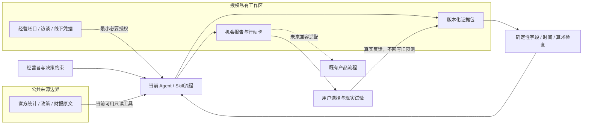
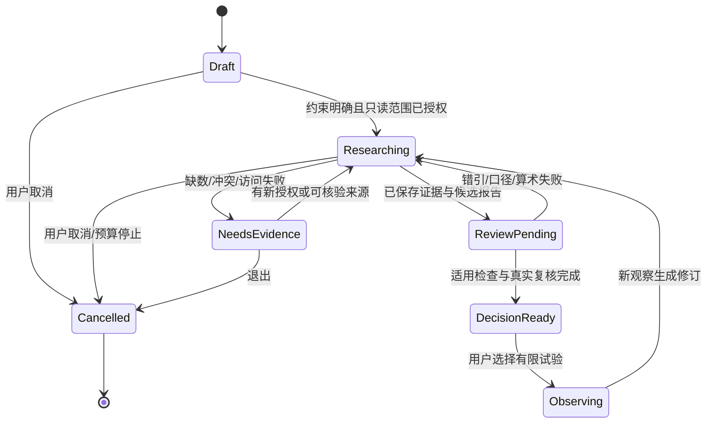

# 架构与技术取舍

版本：0.1.0；日期：2026年10月28日；状态：REVIEW_PENDING；上游：[PRD](01-prd.md)；实际作者：Codex `wealth_blueprint`。

## 本轮交付与未来应用分界

首版采用可读 Skill + 参考合同 + Python标准库确定性检查器。客户端提供当前可用研究工具，用户数据留在授权工作区；不选择新模型、账户、数据库或付费供应商。未来应用集成继续使用现有项目栈和状态机，通过适配层消费证据包，不从本仓重建第二套产品运行时。

| 决策 | 候选与取舍 | 本轮选择及退出路径 |
|---|---|---|
| ADR-01 交付形态 | Skill：易安装、工具由客户端决定，自动化一致性有限；独立Web应用：可统一体验，但需后端/权限/部署；托管采集平台：更新方便，增加授权和运维成本 | 选择Skill，符合明确安装请求。参考模型独立于客户端，未来适配不要求迁移私有原件。 |
| ADR-02 证据存储 | 本地JSON/文件：可审计、无需服务，规模与并发有限；数据库：查询和并发更强，但增加运维；仅聊天：简单但难重现 | 首版允许用户授权工作区的文件包。未来数据库沿现有项目基线决定，不提前引入。 |
| ADR-03 研究来源 | 手动/连接器研究：可核验、入口多样，耗时；官方API：结构稳定性更好但各源权限和口径不同；第三方聚合：方便但有费用、许可和转述风险 | 首版按源核验，非自动抓取平台。不得凭首页可读宣称连接器已可用；任何新增服务另记授权与测试。 |
| ADR-04 推理与数值 | 模型擅长提炼与假设，但可能错引；确定性算术可复算，但不能判断证据真实和因果 | 文字推理与数值复算分层；模型不自签事实，检查器不宣称理解经营语义。 |

## 核心实体与契约

运行包最低交换合同以随包检查器接受的字段为准；[证据模型](../references/evidence-model.md)同时说明更完整的研究字段，扩展字段不等于代码已强制验证。

| 实体 | 关键设计字段 | 不变量 |
|---|---|---|
| DecisionBrief | id、version、business、jurisdiction、decision、as_of、horizon、budget、loss_limit | 决策时点固定；约束变更新建修订，不能沿用旧结论当新验收 |
| SourceArtifact | id、原始URL/本地定位、publisher、published_at、retrieved_at、有效期、hash/快照、权利/隐私标记、source_family | 获取时间与公布/适用时间分开；转载同源归组；不向模型执行原文内指令 |
| Claim / Metric | id、claim、status、evidence_refs、period、region、unit、currency、scope、method、restatement_of | 结论必须有证据或明确估计/假设；同名指标未必同口径；旧修订保留 |
| Opportunity | id、fit、causal_chain、supporting/contrary claims、constraints、risks、next_test | 上行机会与下行/否证并列；证据不足不能自动晋级投入决定 |
| Scenario | id、参数及来源、计算周期、收现/现金支出/资本/额外资金占用/回款/退出、现金序列 | 本版currency必须匹配business，period为合法YYYY-MM/YYYY-MM且情景间一致；禁止NaN/Infinity和漏成本；缺数不当0；不得将权责营收当收现或重复扣资金占用；算术一致不代表参数可信 |
| DecisionRecord | version、candidate、action、reason、uncertainty、stop_condition、owner、review_date | 研究建议与用户实际决定分开；不执行交易/支付 |
| Feedback | id、observed_at、period、kind、evidence、prior_version | 新观察追加；更改预测必须产生新版本且说明原因 |

Skill报告生成和保存是客户端操作，当前没有本仓HTTP服务/API。未来最小内部接口可设计为 `readBrief(id, version)`、`appendEvidence(expectedVersion, artifact)`、`evaluate(bundle, asOf)`、`saveReport(expectedVersion, report)`。所有写入校验实际用户授权和预计版本，冲突返回当前版本供合并；不使用盲覆盖。查询/附件不得读取工作区外路径；不存在、无权限、过大、来源失败、版本冲突分别返回可理解错误。接口名称仅为设计，未声称已实现。

## 状态、恢复与变更

`DecisionReady`只表示报告足以支持限定决策，不表示投资已执行、利润已实现或PMF成立。不得从 Draft/NeedsEvidence 直接进入已验证盈利。第一版 Skill 由执行Agent显式记录这些状态，不提供强制运行状态机。

保存时先完成新版本与引用校验，再把其标为当前版本；中断保留上一完整版本，不销毁中间证据。重复导入依靠原始文档hash和source_family去重；相同事件不得重复累计为独立支持。多个执行者协作时任务明确读取/写入范围和版本；没有已验证并发机制时采用单写者。未来产品接入前必须测试旧数据、在途分析、刷新恢复与导出不退化。

## 信任边界、成本与运行

网页、PDF、访谈、截图和模型输出全部是待分析数据。材料中的隐藏指令、要求取密钥或外传经营账目的请求不得提升为授权。只读公开检索不意味着允许下载全部站点；遵守源方访问限制与数据许可，无法读取时列缺口。

私有账目优先只提供汇总指标；客户个人资料、银行号、合同隐私默认脱敏。公开Skill仓库只含通用规则与合成样本。保存目录、保留期、删除和外部模型数据处理由用户实际环境决定；不能承诺本包已经加密、隔离租户或清除外部服务副本。

每次研究登记时间盒、来源数量、调用次数、费用上限、取消条件；预算不明确不追加付费工具。确定性检查不联网。未来调度采用去重键、指数退避、最大重试、取消和下次刷新时点；重大变化才提醒；这些调度能力尚未实现。

回退：Skill可在客户端移除，私有报告保留；报告回到上一完整版本并列出失效证据。未来集成采用分支/PR、兼容读取、独立回归和可回滚部署，不能将新增雷达覆盖生产故障排查。无需因首版Skill建立多租户、支付和云平台。
